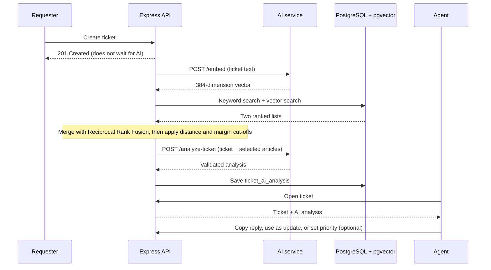

# AI and Knowledge Retrieval

## Status

Implemented. A FastAPI service analyses each new ticket, and the API feeds it relevant knowledge-base articles found by hybrid search. Agents see the result on the ticket page and decide what to do with it.

## Flow

Ticket creation never waits for the AI. If the AI service is unreachable, slow or returns invalid output, the ticket is still created and the failure is logged; the agent simply sees no analysis card.

## What the analysis contains

- Suggested category and priority, and an urgency label
- A short summary
- Suggested support team
- The knowledge-base articles used
- A draft reply
- The provider and model that produced it, and when

This is stored in `ticket_ai_analysis`, separate from the ticket's own category and priority. The agent can:

- copy the draft reply or place it into the update box and edit it before posting,
- apply the suggested priority with one click,
- or ignore everything.

If the suggested category differs from the ticket's, the card shows the original beside it. No suggestion ever assigns, resolves or closes a ticket.

## Retrieval

Each article is embedded once with a 384-dimension `bge-small` model and stored in a pgvector column. For a new ticket the API runs two searches over the same articles:

1. **Keyword search**, a Postgres full-text query that matches any of the ticket's terms.
2. **Vector search**, cosine distance between the ticket embedding and each article.

The two ranked lists are merged with **Reciprocal Rank Fusion**, which rewards articles that rank well in both and needs no score tuning. Two cut-offs then remove weak matches, because a ranked list always returns *something* even when nothing is relevant:

| Setting | Default | Meaning |
| --- | --- | --- |
| `KB_MAX_DISTANCE` | `0.40` | Drop vector matches farther than this |
| `KB_MARGIN` | `0.10` | Only keep matches within this margin of the best one |

These values came from measuring real distances on test tickets: clearly unrelated articles scored between 0.41 and 0.51, so the cut-off sits just below that range. Re-measure and adjust if the article set changes a lot.

Only articles that survive both cut-offs reach the AI service. If none do, the reply is written without articles and the card shows "None matched".

## Service contract

| Endpoint | Purpose |
| --- | --- |
| `POST /embed` | Turn text into an embedding vector |
| `POST /analyze-ticket` | Return category, priority, urgency, summary, suggested team, article references and a suggested reply |

Requests carry a shared token in the `X-Service-Token` header. The model provider sits behind an adapter inside the service, so it can be swapped without touching the API. All output is validated against a schema before it is returned.

## Safety

- Credentials stay in environment variables and are never sent to the browser.
- The API treats any failure of the AI service as "no analysis".
- The AI service receives only the ticket and the selected articles.
- The AI never performs an action. It produces text a person can use or ignore.

## Testing

API tests run with the AI service deliberately unreachable and confirm that ticket creation, assignment and status changes still succeed. Add malformed-response tests next to the service itself when you change the output schema.
