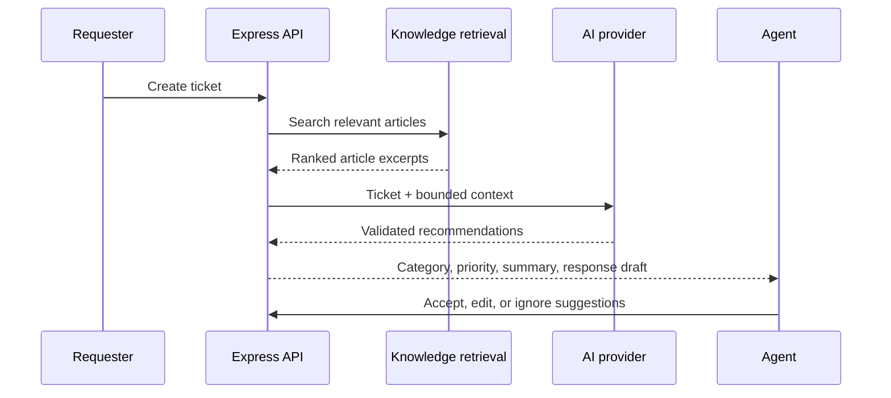

# AI and Knowledge Retrieval

## Status

AI ticket analysis and knowledge retrieval are planned; no model is called in Phase 1. The API currently creates and manages tickets, calculates SLAs, and records audit events without an AI dependency.

## Planned service boundary

The later AI phase will add a small Python/FastAPI service with a versioned request/response contract. The Express API remains the system of record and will send only the information needed to classify a ticket and retrieve suggested articles.

## Planned output

- Category and priority suggestions
- Concise summary and urgency signal
- Suggested support team
- Relevant knowledge articles
- Draft response
- Possible duplicate candidates

All output will be schema-validated and stored separately from the ticket's human-approved values. AI suggestions will never assign, resolve, close, or otherwise perform a consequential action without human approval.

## Planned retrieval

Start with PostgreSQL text search over published articles and tags. Add embeddings or a vector index only if measured relevance justifies the additional operational cost. Store article references and retrieval evidence with analysis results so agents can inspect why a suggestion appeared.

## Provider and safety requirements

Use a Replit-managed AI integration or another provider behind the AI service adapter; keep credentials in secrets, never in Git or the browser. Add timeouts, bounded retries, response validation, PII minimization, clear fallback behavior, and tests for invalid output and unavailable providers before enabling the feature.
