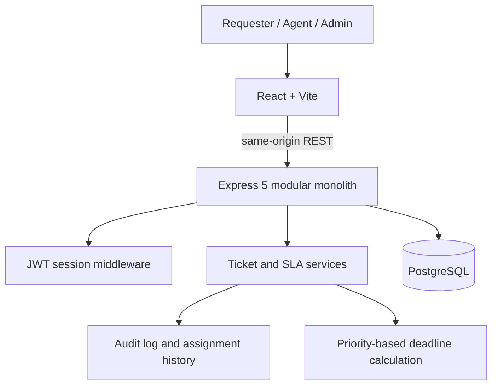
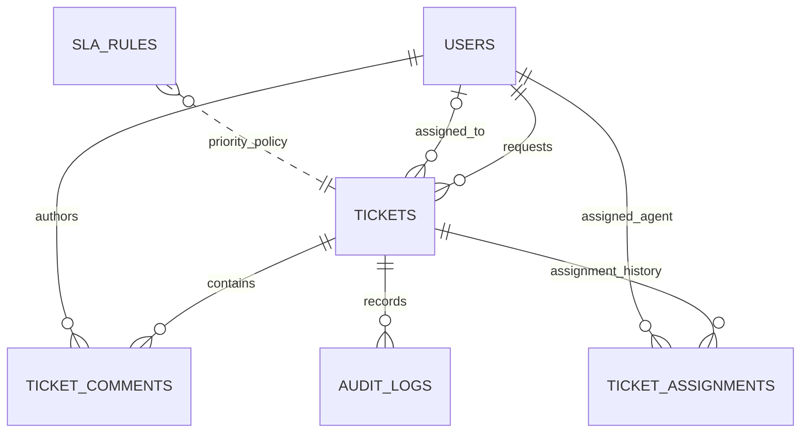
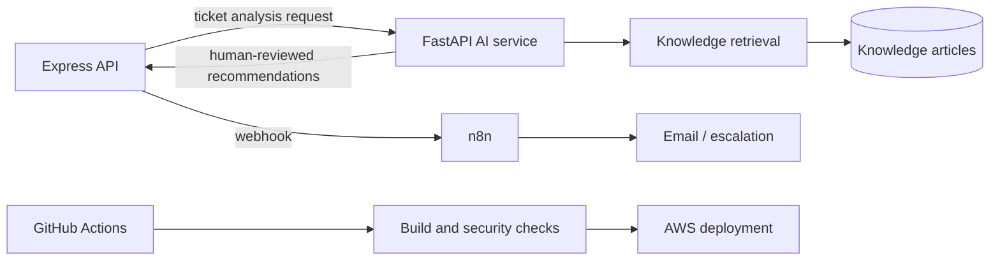

# Architecture

## Current system

The browser and API are served under one project domain. The API is routed at `/api`; requests use a same-origin, HttpOnly session cookie.

## Source of truth

- `lib/api-spec/openapi.yaml` defines request and response contracts.
- `lib/api-client-react/src/generated/` contains generated React Query hooks.
- `lib/api-zod/src/generated/` contains generated Zod schemas used by the API.
- `lib/db/src/schema/` defines users, tickets, comments, assignments, SLA rules, and audit logs.
- `artifacts/api-server/src/routes/` contains HTTP routing. Shared access and SLA behavior lives under `src/lib/`.
- `artifacts/helpdesk-ai/src/` contains the React application.

Regenerate API helpers after each contract change with `pnpm --filter @workspace/api-spec run codegen`.

## Request flow

1. A requester registers or signs in. The API verifies a bcrypt password hash and sets a signed, seven-day JWT in an HttpOnly cookie.
2. Protected endpoints verify the JWT and load the current account and role from PostgreSQL.
3. Ticket reads are scoped by role: requesters see their own tickets; agents see their assignments and unassigned work; admins see all tickets.
4. Ticket creation and priority changes derive the SLA deadline from the matching `sla_rules` row.
5. Status, assignment, priority, and comment changes are recorded in `audit_logs`; assignment changes are also retained in `ticket_assignments`.
6. The frontend uses generated hooks and invalidates affected ticket, detail, and dashboard queries after mutations.

## Role permissions in Phase 1

| Capability | Requester | Agent | Admin |
| --- | --- | --- | --- |
| Create a ticket | Yes | Yes | Yes |
| View tickets | Own | Assigned and unassigned | All |
| Comment | Public | Public or internal | Public or internal |
| Set status | Close own resolved tickets | Progress assigned/unassigned tickets | Progress tickets |
| Change priority | No | Yes | Yes |
| Assign/reassign | No | Yes | Yes |
| View dashboard | Scoped to own tickets | Scoped to queue | All tickets |

Admin user management and SLA-rule editing are planned follow-up phases.

## Data model

## Planned additions

These services are not enabled in the current phase.
