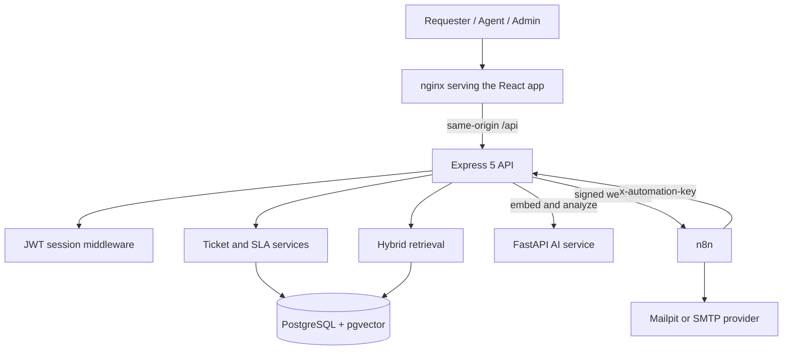
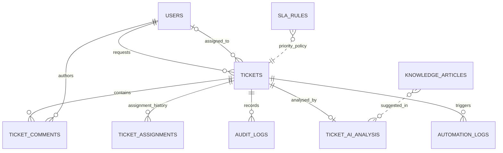

# Architecture

## System overview

The browser only ever talks to nginx. nginx serves the built React app and forwards `/api` to the API container, so requests are same-origin and the session cookie is HttpOnly. The API is the single source of truth: the AI service and n8n never write to the database directly.

## Services

| Service | Role | Port (local) |
| --- | --- | --- |
| `web` | nginx serving the React build, proxying `/api` | 8080 |
| `api` | Express API; the only component that talks to the database | internal 3001 |
| `db-setup` | One-off job that applies the schema, then exits | none |
| `mailpit` | Catches outgoing email in development | 8025 (UI), 1025 (SMTP) |
| `n8n` | Runs the four automation workflows | 5678 |
| AI service | FastAPI app that embeds text and analyses tickets | 8000 on the host |

The database is a managed PostgreSQL (Neon) with the pgvector extension. Two Compose profiles exist for development: `seed` (demo data) and `test` (a throwaway Postgres for the API test suite).

## Source of truth

- `lib/api-spec/openapi.yaml` defines every request and response.
- `lib/api-zod/` holds the generated Zod schemas the API validates with.
- `lib/api-client-react/` holds the generated React Query hooks the frontend uses.
- `lib/db/src/schema/` defines the tables.
- `artifacts/api-server/src/routes/` holds the HTTP routes; shared rules live in `src/lib/`.
- `artifacts/helpdesk-ai/src/` holds the React app, split into `pages/`, `components/` and `lib/`.

Regenerate after any contract change with `pnpm --filter @workspace/api-spec run codegen`.

## Request flow

1. A user registers or signs in. The API checks a bcrypt hash and sets a signed seven-day JWT in an HttpOnly cookie.
2. Every protected request verifies the token and reloads the user and role from the database.
3. Ticket reads are scoped by role: requesters see their own tickets, agents see their assignments and unassigned work, admins see everything.
4. Creating a ticket or changing its priority sets the SLA deadline from the matching SLA rule.
5. Status, assignment, priority and comment changes are written to the audit log; assignments are also kept in assignment history.
6. After a ticket is created, the API starts the AI analysis in the background (see [AI.md](AI.md)) and sends a signed event to n8n (see [N8N_WORKFLOWS.md](N8N_WORKFLOWS.md)). Neither can block or fail ticket creation.

## Role permissions

| Capability | Requester | Agent | Admin |
| --- | --- | --- | --- |
| Create a ticket | Yes | Yes | Yes |
| View tickets | Own | Assigned and unassigned | All |
| Comment | Public | Public or internal | Public or internal |
| Set status | Close own resolved tickets | Progress assigned or unassigned tickets | Progress any ticket |
| Change priority | No | Yes | Yes |
| Assign or reassign | No | Yes | Yes |
| See AI analysis | No | Yes | Yes |
| Manage users and roles | No | No | Yes |
| Edit SLA hours | No | No | Yes |
| View automation runs | No | No | Yes |
| Dashboard | Own tickets | Own queue | All tickets |

The admin area protects against lock-outs: an admin cannot change their own role or deactivate themselves, and role and status changes take a user's open assigned tickets into account. Every admin change is written to the audit log, and passwords are never logged.

## Data model

- `knowledge_articles` stores each article with its 384-dimension embedding in a pgvector column.
- `ticket_ai_analysis` stores the AI output separately from the ticket's human-approved values, with the provider, model and the articles that were used.
- `automation_logs` has one row per workflow run, unique on `(workflow, event_id)` so a replayed event updates the same row instead of duplicating it.

## Design decisions

- **Modular monolith.** One API owns all rules and data. It is simpler to run and test than separate services, and fits a free single-VM deployment.
- **Signed, one-way events.** The API signs outgoing webhooks with HMAC-SHA256. n8n calls back using a separate shared key, compared in constant time. The two secrets are different, so leaking one does not give access in the other direction.
- **Idempotent automation.** Event identifiers are stable (for example `ticket-created:<id>`), so retries never send duplicate emails or duplicate log rows.
- **Suggestions, never actions.** AI output cannot assign, resolve or close a ticket. An agent applies it by hand.
