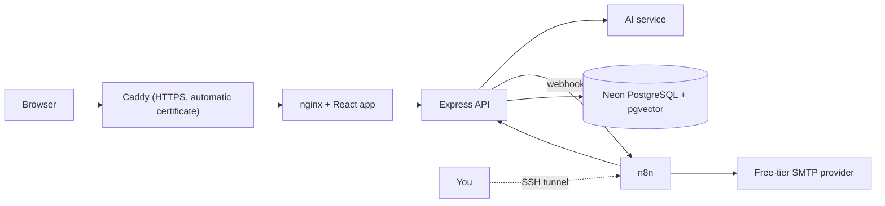

# Deployment

## Status

The whole stack runs locally with Docker Compose (`docker compose up -d --build`). The production setup below is **in preparation**: the steps describe the intended free deployment, and each one is marked when it is done. There is no paid cloud infrastructure in this project; AWS and Terraform were deliberately left out so the portfolio demo can stay free.

## Goal

A public HTTPS URL for the portfolio, running at no cost, with the same containers used locally.

## Target setup



Everything except the database and the email provider runs on one small virtual machine with Docker Compose. Caddy terminates HTTPS and gets certificates automatically. n8n is never exposed to the internet; you reach it through an SSH tunnel when you need to edit workflows.

| Piece | Free option | Notes |
| --- | --- | --- |
| Server | A free-tier virtual machine, for example Oracle Cloud Always Free | Free-tier availability and terms change; check them when you sign up |
| Database | Neon free plan | Already used in development. Use a separate project or branch for production |
| Domain | A free DuckDNS subdomain such as `yourname.duckdns.org` | Points at the VM's public IP |
| HTTPS | Caddy | Certificates are issued and renewed automatically |
| Email | A free-tier SMTP provider, or a Gmail app password for a low-volume demo | Replaces Mailpit. Check the current daily limit |
| Fallbacks | Run from your own machine behind a free tunnel (for example Cloudflare Tunnel), or publish a recorded demo with screenshots | Good enough for a portfolio if a VM is not available |

## Production configuration

Use a **new** `.env` for production with freshly generated secrets. Never reuse the development values.

| Variable | Production value |
| --- | --- |
| `NEON_DATABASE_URL` | The production database, ending in `?sslmode=require` |
| `SESSION_SECRET`, `AI_SERVICE_TOKEN`, `AUTOMATION_WEBHOOK_SECRET`, `AUTOMATION_API_KEY`, `N8N_ENCRYPTION_KEY` | New random values (64 hex characters each) |
| `COOKIE_SECURE` | `true` |
| `CORS_ORIGIN` | `https://yourname.duckdns.org` |
| `TRUST_PROXY` | `2`: Caddy and the web container's nginx are two proxies in front of the API |
| `LOG_LEVEL` | `info` |
| SMTP settings | The provider's host, port, username and password |

Also:

- Bind the web container to `127.0.0.1` so only Caddy can reach it, and remove the published Mailpit ports.
- Keep n8n on `127.0.0.1:5678` only.
- Enable the vector extension in the production database once: `CREATE EXTENSION IF NOT EXISTS vector;`. The `db-setup` job then creates the tables on every start.
- Never run the demo seed in production. It refuses to run when `NODE_ENV=production`.

## Checklist before the first deploy

- [ ] Replace the placeholders baked into the n8n workflows: the support and admin email addresses and the `http://localhost:8080` links. Re-export them to `automation/workflows/`.
- [ ] Set the resolution follow-up wait from 1 minute to about 24 hours.
- [ ] Pin the n8n image to an exact version tag instead of `latest`.
- [ ] Containerize the AI service so it starts with the rest of the stack (today it runs on the host at port 8000).
- [ ] Add the production Compose overlay and the Caddyfile.
- [ ] Confirm `.env` is not committed and generate production secrets.
- [ ] Make sure the first admin can be created (see below).

## Creating the first admin

The demo seed cannot run in production, so create the first admin by hand: register an account through the app, then promote it once in the database:

```sql
UPDATE users SET role = 'admin' WHERE email = 'you@example.com';
```

Use a strong password. Create further users from **Admin → Users**.

## Deployment steps

1. **Prepare the server.** Create the VM, open ports 80 and 443 only (plus SSH), install Docker and Docker Compose.
2. **Point the domain.** Create the DuckDNS subdomain and set it to the VM's public IP.
3. **Copy the project.** Clone the repository onto the VM and add the production `.env`.
4. **Start the stack.** `docker compose -f docker-compose.yml -f docker-compose.prod.yml up -d --build`.
5. **Set up n8n.** Open an SSH tunnel (`ssh -L 5678:127.0.0.1:5678 user@server`), browse to `http://localhost:5678`, create the owner account, import the four workflows, add the SMTP credential and publish them.
6. **Create the first admin** as above and sign in.
7. **Smoke test.** Create a ticket and check that the AI card appears, the new-ticket email arrives and a row shows up in **Admin → Automation**.

## Automated deployment (planned)

A GitHub Actions workflow will run typecheck, tests, builds and Docker builds on every push. A second workflow will deploy only when that workflow succeeds, by connecting to the VM over SSH, pulling the new code and restarting the stack. The SSH key and server address live in GitHub repository secrets, never in the repository.

## Monitoring (lightweight)

- `GET /api/healthz` and Docker health checks on the containers.
- A free external uptime monitor pointed at `/api/healthz`, with email alerts.
- `docker compose logs` for the API and n8n, with log rotation enabled so the disk does not fill.
- **Admin → Automation** shows every workflow success and failure.
- Neon's dashboard for database health and backups.

## Rolling back

Keep the previous image tag. To roll back, check out the earlier commit on the server and run the same `up -d --build` command. Database changes are applied by `drizzle-kit push`; avoid destructive schema changes without a backup.
