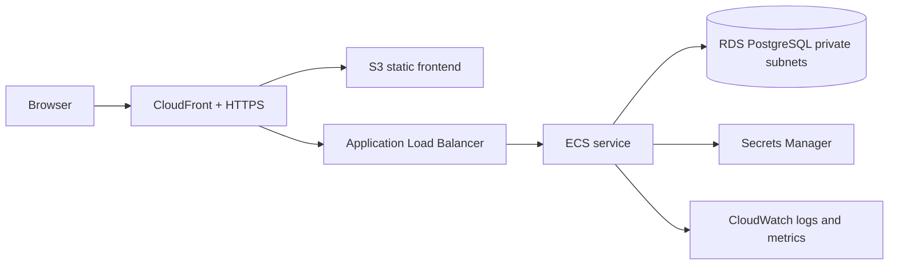

# Deployment

## Current status

The Phase 1 app runs in Replit through its managed web and API workflows and uses the workspace PostgreSQL database. AWS, Docker Compose, Terraform, and GitHub Actions deployment are later phases; there is no AWS infrastructure to deploy yet.

## Replit development setup

1. Ensure the development database is available.
2. Apply the development schema:

   ```bash
   pnpm --filter @workspace/db run push
   ```

3. Add the development seed data:

   ```bash
   pnpm --filter @workspace/api-server run seed
   ```

4. Start/restart the configured API and web workflows from the workspace.
5. Run the project typecheck:

   ```bash
   pnpm run typecheck
   ```

Replit supplies `PORT`, `BASE_PATH`, and `DATABASE_URL` to the managed workflows. Do not hardcode these values in application source.

## Required production configuration

- `DATABASE_URL`: managed or securely provisioned PostgreSQL connection.
- `SESSION_SECRET`: at least 32 characters, stored in the platform secret store.
- `CORS_ORIGIN`: set only when the frontend is hosted on a different origin; list exact allowed origins.
- `NODE_ENV=production`: enables Secure cookies and production logging behavior.

Never run the demo seed against production. The seed script explicitly exits when `NODE_ENV` is `production`.

## Future AWS target

The planned portfolio deployment is a small, single-region setup:



Terraform should own the VPC, public/private subnets, security groups, load balancer, ECS service, RDS, IAM roles, and log groups. Keep the database private and grant the app task only the permissions it needs. Do not create cloud resources until the Docker and deployment phases are ready and AWS credentials have been configured securely.

## Release pipeline target

GitHub Actions will later run typecheck, tests, builds, container scans, and image publishing. Deployment must depend on successful CI and use short-lived or narrowly scoped AWS credentials rather than repository-committed keys.
