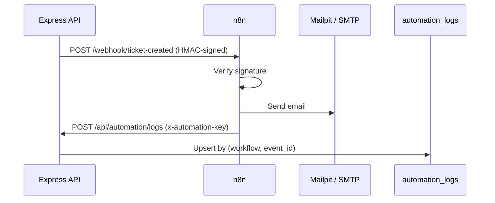

# n8n Workflows

## Status

Implemented and tested end to end. Four workflows run in n8n, every run is recorded in `automation_logs`, and admins can review successes and failures on the **Admin → Automation** tab. In development all email goes to Mailpit, so nothing real is ever sent.

## The four workflows

| Workflow | Trigger | What it does | Recipient |
| --- | --- | --- | --- |
| **New ticket** (`new-ticket`) | Signed webhook `ticket-created` | Emails the support inbox with the title, priority, category, requester and a link | Support address |
| **SLA warning** (`sla-warning`) | Schedule, every 5 minutes | Asks the API for tickets at 75% or more of their SLA window, and emails each assigned agent | The assigned agent |
| **Resolution follow-up** (`resolution-followup`) | Signed webhook `ticket-resolved` | Waits, then emails the requester asking how support went | The requester |
| **P1 escalation** (`p1-escalation`) | Signed webhook `ticket-p1` | Emails an admin that a critical ticket needs attention. Fires when a ticket is created as P1 or raised to P1 | Admin address |

The workflow files are exported to `automation/workflows/` (`new-ticket.json`, `sla-warning.json`, `resolution-followup.json`, `p1-escalation.json`). Import each into its **own** new workflow; importing into a canvas that already has nodes merges them.

## How the pieces talk

- **Outbound events.** The API signs the JSON body with HMAC-SHA256 using `AUTOMATION_WEBHOOK_SECRET` and sends the result in the `x-helpdesk-signature` header. The first node in each webhook workflow recomputes the signature and rejects anything that does not match.
- **Callbacks.** n8n calls the API with the `x-automation-key` header (`AUTOMATION_API_KEY`), checked in constant time. It never touches the database directly.
- **Fire and forget.** The API sends the event with a short timeout and logs a warning if n8n is unreachable. A missing n8n never blocks ticket creation.
- **Idempotent.** Each event has a stable id, for example `ticket-created:<ticketId>`. `automation_logs` is unique on `(workflow, event_id)`, so a retry updates the same row. The SLA warning is sent once per ticket: tickets that already have a successful `sla-warning` log are skipped.

## What gets logged

One row per run: workflow name, event id, ticket, `success` or `failure`, start and finish times, and a short, truncated error summary. If the Send email step fails, a separate *Log failure* node records the error. No cookies, passwords, secrets or full ticket text are stored.

## Setting up n8n locally

1. Open http://localhost:5678 and create the owner account (local only; n8n has its own login).
2. Import each workflow file as a new workflow.
3. Create an SMTP credential: host `mailpit`, port `1025`, no authentication, SSL off. Select it in every *Send email* node.
4. In each email node's options, switch off **Append n8n Attribution** if you do not want the footer.
5. Publish all four workflows. Re-publish after any edit; saving alone does not change the running version.

The environment values n8n needs (`API_BASE_URL`, `AUTOMATION_API_KEY`, `AUTOMATION_WEBHOOK_SECRET`) are set in `docker-compose.yml`. Workflows read them as `$env.*`, which shows as "not accessible" in the editor but resolves at run time.

## Testing a workflow

1. Create a ticket as a requester (use P1 to trigger two workflows at once). Open Mailpit and expect the new-ticket and P1 emails.
2. Move a ticket through `assigned → in_progress → resolved`. The follow-up email arrives after the wait.
3. For an SLA warning, make a test ticket look old in the database (move `created_at` back and `sla_deadline` forward so it is 75% used) and wait up to 5 minutes.
4. Open **Admin → Automation** to see the runs. To see a failure, run `docker compose stop mailpit`, create a ticket, then `docker compose start mailpit`.

## Before using real email

These values are set for development and must change for a real deployment:

- **Recipients and links.** The support and admin addresses (`support@helpdesk.local`, `admin@helpdesk.local`) and the `http://localhost:8080` links are written into the workflows. Replace them with real addresses and the public URL.
- **Wait time.** The resolution follow-up waits 1 minute for testing. Set it to something like 24 hours.
- **SMTP.** Replace the Mailpit credential with a real SMTP provider's credential. See [DEPLOYMENT.md](DEPLOYMENT.md).
- **Exposure.** Keep n8n bound to localhost on a server and reach it through an SSH tunnel. Do not publish port 5678.
- **Versions.** Pin the n8n and Mailpit image tags instead of `latest`.
