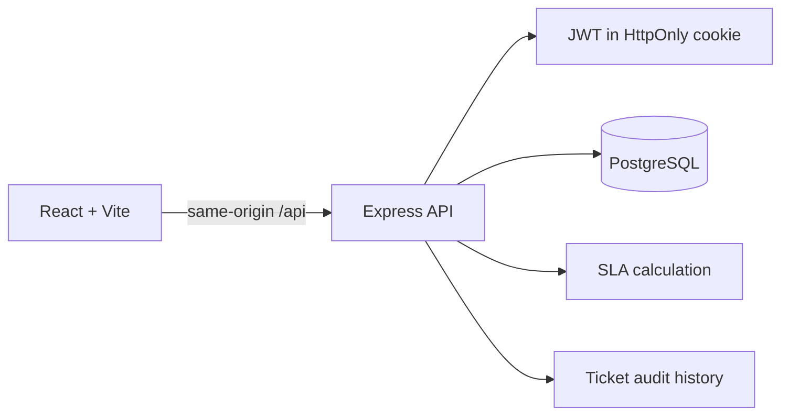

# HelpDeskAI

HelpDeskAI is a cloud-native IT helpdesk portfolio project. Requesters submit and follow support issues; agents and admins manage ownership, progress, priority, and service-level commitments.

## Current phase

**Phase 1 is implemented:** PostgreSQL-backed accounts and tickets, role-based access, SLA deadlines, comments and internal notes, assignment history, audit events, dashboard summaries, and a working React interface.

AI ticket analysis, the knowledge base, n8n workflows, Docker, AWS, Terraform, CI/CD, and CloudWatch are documented as later phases. They are not represented as working features yet.

## Architecture



The main application is a modular monolith. The OpenAPI document is the API contract; generated Zod schemas validate server inputs and outputs, and generated React Query hooks connect the frontend.

See [ARCHITECTURE.md](ARCHITECTURE.md), [SECURITY.md](SECURITY.md), [DEPLOYMENT.md](DEPLOYMENT.md), [AI.md](AI.md), and [N8N_WORKFLOWS.md](N8N_WORKFLOWS.md).

## Phase 1 features

- Requester registration and sign-in; agent and admin roles for seeded demo users.
- HttpOnly JWT sessions, password hashing, protected routes, and role-aware ticket visibility.
- Ticket creation, search and filtering, detail pages, comments, and agent-only internal notes.
- Agent assignment and reassignment, priority updates, and linear ticket status transitions.
- Priority SLAs: P1 1 hour, P2 4 hours, P3 8 hours, P4 24 hours. Tickets at 75% elapsed are marked at risk; expired deadlines are marked breached.
- Requester dashboard, agent queue, operational summary, and auditable ticket changes.
- Responsive UI with loading, empty, error, and mutation feedback states.

Ticket lifecycle: `new → assigned → in_progress → resolved → closed`. Requesters can close their own resolved tickets.

## Stack

- React, Vite, TypeScript, Wouter, TanStack Query
- Node.js, Express 5, TypeScript
- PostgreSQL, Drizzle ORM
- OpenAPI, Orval-generated client hooks and Zod schemas
- Pino structured logs, Helmet, express-rate-limit

## Run in Replit

The API and web preview workflows are configured for this project. To initialize an empty development database, run:

```bash
pnpm --filter @workspace/db run push
pnpm --filter @workspace/api-server run seed
```

The seed command is development-only. It refuses to run when `NODE_ENV=production`.

Demo users (password for all accounts: `HelpdeskDemo26!`):

| Role | Email |
| --- | --- |
| Requester | `requester@helpdesk.local` |
| Agent | `agent@helpdesk.local` |
| Admin | `admin@helpdesk.local` |

Do not use these demo accounts or their password in production.

## Environment

| Variable | Required | Purpose |
| --- | --- | --- |
| `DATABASE_URL` | Yes | PostgreSQL connection supplied by the workspace |
| `SESSION_SECRET` | Yes | At least 32 characters; signs session JWTs |
| `CORS_ORIGIN` | No | Comma-separated allowlist for a separately hosted frontend |
| `DEMO_PASSWORD` | No | Overrides the development seed password |
| `LOG_LEVEL` | No | Pino log level; defaults to `info` |

Keep secrets in Replit Secrets or the deployment platform's secret store. Never commit `.env` files, JWT signing secrets, or cloud credentials.

## API overview

- `POST /api/auth/register`, `POST /api/auth/login`, `POST /api/auth/logout`, `GET /api/auth/me`
- `GET /api/tickets`, `POST /api/tickets`, `GET /api/tickets/{ticketId}`
- `POST /api/tickets/{ticketId}/comments`
- `PATCH /api/tickets/{ticketId}/status`
- `PATCH /api/tickets/{ticketId}/assignment`
- `PATCH /api/tickets/{ticketId}/priority`
- `GET /api/dashboard/summary`, `GET /api/users/agents`

Contract source: `lib/api-spec/openapi.yaml`. After changing it, regenerate types and hooks:

```bash
pnpm --filter @workspace/api-spec run codegen
```

## Validation

```bash
pnpm run typecheck
pnpm --filter @workspace/api-server run test:unit
```

The unit suite covers priority-based SLA deadlines and states, role-based ticket visibility, status transitions, and assignment behavior. The API startup logs use structured Pino output. The database schema is managed in `lib/db/src/schema/`; `drizzle-kit push` updates the development database.

## Roadmap

1. **Core app (current):** auth, roles, tickets, SLA calculations, audit history, and first dashboard.
2. **Docker:** containerize the web app, API, AI service, and database-backed local setup.
3. **AI and knowledge:** separate FastAPI analysis service, article retrieval, human-approved recommendations.
4. **Automation:** real n8n workflows for new tickets, SLA warnings, resolutions, and escalation.
5. **Cloud and delivery:** AWS architecture, Terraform, GitHub Actions, monitoring, and security hardening.

Suggested phase-one commit: `feat: build HelpDeskAI ticketing foundation`
